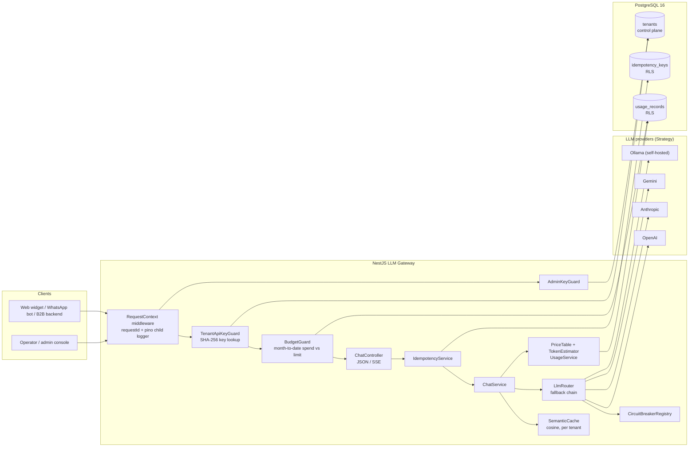

# Multi-tenant LLM Gateway

[](https://github.com/Juankia/multitenant-llm-gateway/actions/workflows/ci.yml)


[](LICENSE)

A **B2B, multi-tenant AI chatbot backend**: one API that many customer companies (tenants) share, each with
its own LLM provider and model, persona, branding and monthly budget, and with its data isolated **by
PostgreSQL itself**.

It covers the parts that tend to break once an LLM feature has paying customers on it:

- **Provider outages.** Each tenant has a fallback chain (OpenAI, Anthropic, Gemini, Ollama) behind a circuit breaker.
- **Cost overruns.** Token and cost use is tracked per tenant and model, with a hard monthly budget that returns `429` and `X-Budget-Reset-At`.
- **Data leaks between tenants.** Row-Level Security policies use `current_setting('app.tenant_id')`.
- **Duplicate charges on retries.** `Idempotency-Key` support.
- **Paying twice for the same answer.** A semantic response cache, plus provider prompt caching.

> Built with NestJS + TypeScript (strict) + PostgreSQL. Every test runs offline. There are no API keys and no database in the test suite.

---

## Contents

- [Features](#features)
- [Architecture](#architecture)
- [Request lifecycle](#request-lifecycle)
- [Quickstart](#quickstart)
- [API by example (curl)](#api-by-example-curl)
- [Tenant isolation with Row-Level Security](#tenant-isolation-with-row-level-security)
- [Design decisions](#design-decisions)
- [Testing](#testing)
- [Project structure](#project-structure)
- [Configuration](#configuration)
- [Production notes & limitations](#production-notes--limitations)
- [Roadmap](#roadmap)
- [About the author](#about-the-author)

## Features

| Area | What it does |
| --- | --- |
| **Tenancy** | Tenants are resolved from an API key (`Authorization: Bearer tgw_…` or `x-api-key`). Only the **SHA-256 hash** of the key is stored. Each tenant has its own provider + model, fallback chain, system prompt, branding and plan limits. |
| **Provider abstraction** | Strategy pattern: `LlmProvider` is implemented by OpenAI, Anthropic, Gemini and Ollama adapters, plus an offline `mock`. All of them use native `fetch` (no vendor SDKs), with SSE/NDJSON streaming parsers. |
| **Resilience** | An ordered **fallback chain** and a three-state **circuit breaker** per provider (closed, open, half-open). Errors are classified: transient errors fall back, invalid requests fail fast. |
| **FinOps** | A usage ledger per request (tokens, cached tokens, cost, latency, fallback/cache flags). A price table matches models by longest prefix. A **hard monthly budget** returns `429` with `X-Budget-Reset-At` and `Retry-After`. When a provider reports no usage, tokens are estimated with **tiktoken**. |
| **Caching** | A `SemanticCache` interface with an in-memory cosine implementation, partitioned per tenant and scoped by persona/context. Anthropic `cache_control` is set on the tenant system prompt, and OpenAI/Gemini cached tokens are priced at the discounted rate. |
| **Isolation** | PostgreSQL **RLS** policies, set per unit of work through `set_config('app.tenant_id', …, true)`. The runtime role is not a superuser and has no `BYPASSRLS`. |
| **API** | `POST /v1/chat` (JSON or **SSE streaming**), `GET /v1/usage`, `GET /v1/me`, admin tenant CRUD + key rotation, `GET /health`, and OpenAPI at **`/docs`**. |
| **Reliability** | `Idempotency-Key` on `POST /v1/chat`: replays on retry, `422` on payload mismatch, `409` while the first request is still running. |
| **Observability** | Structured JSON logs (pino). AsyncLocalStorage carries `requestId` and `tenantId` on every log line, and `X-Request-Id` is propagated. |

## Architecture



## Request lifecycle

```mermaid
sequenceDiagram
    autonumber
    participant C as Client
    participant G as Guards (tenant + budget)
    participant I as Idempotency
    participant S as ChatService
    participant K as Semantic cache
    participant R as LlmRouter
    participant P1 as Primary provider
    participant P2 as Fallback provider
    participant DB as Postgres (RLS)

    C->>G: POST /v1/chat (Bearer key, Idempotency-Key)
    G->>DB: tenant by sha256(key)
    G->>DB: SET LOCAL app.tenant_id, SUM(cost) this month
    alt budget exhausted
        G-->>C: 429 + X-Budget-Reset-At + Retry-After
    end
    G->>I: claim (tenant, key, sha256(body))
    alt key already completed
        I-->>C: 200 stored response (Idempotent-Replayed: true)
    end
    I->>S: execute
    S->>K: lookup(tenant, scope, last user message)
    alt cache hit (cosine >= threshold)
        K-->>S: cached answer (cost $0)
    else miss
        S->>R: complete(chain = primary + fallbacks)
        R->>P1: request (circuit closed?)
        P1--xR: 503 / timeout
        R->>P2: request
        P2-->>R: answer + usage (or none)
        R-->>S: result, target, attempts
        S->>S: usage = provider usage or tiktoken estimate; cost = price table
        S->>K: store
    end
    S->>DB: INSERT usage_records (under RLS)
    S-->>I: response
    I->>DB: store response for replay
    I-->>C: 200 JSON (or SSE: meta, delta…, done)
```

## Quickstart

### Option A: zero dependencies (in-memory, offline mock provider)

```bash
npm install
cp .env.example .env          # set ADMIN_API_KEY to a long random string
npm run start:dev             # http://localhost:3000, OpenAPI UI at http://localhost:3000/docs
```

`PERSISTENCE=memory` and the built-in `mock` provider mean you can try every endpoint without a
database or any LLM key. Add `OPENAI_API_KEY`, `ANTHROPIC_API_KEY`, `GEMINI_API_KEY` or
`OLLAMA_BASE_URL` to route to real models.

### Option B: Docker Compose (API + PostgreSQL with RLS)

```bash
cp .env.example .env          # set ADMIN_API_KEY (and optionally provider keys)
docker compose up --build     # API on :3000, Postgres on :5432
```

On first start, Postgres runs the files in [`db/migrations`](db/migrations) in this order:
the runtime role, then the schema, then the RLS policies. The API connects as the restricted
`gateway_app` role. If a host port is taken, override it with `API_HOST_PORT` or `POSTGRES_HOST_PORT`.
Reset everything with `docker compose down -v`.

## API by example (curl)

```bash
export GW=http://localhost:3000
export ADMIN_KEY=<your ADMIN_API_KEY>
```

**1. Create a tenant (admin).** The API key is returned **once**:

```bash
curl -s -X POST $GW/admin/tenants \
  -H "x-admin-key: $ADMIN_KEY" -H 'content-type: application/json' \
  -d '{
    "name": "Acme Insurance",
    "slug": "acme-insurance",
    "plan": "pro",
    "primary":   { "provider": "openai",    "model": "gpt-4o-mini" },
    "fallbacks": [{ "provider": "anthropic", "model": "claude-haiku-4-5" },
                  { "provider": "mock",      "model": "demo" }],
    "systemPrompt": "You are Aria, the support assistant of Acme Insurance. Be concise.",
    "branding": { "assistantName": "Aria", "primaryColor": "#0F766E" },
    "monthlyBudgetUsd": 50
  }'
# => { "tenant": { "id": "…", "apiKeyPrefix": "tgw_3Kq…", "limits": {…}, … }, "apiKey": "tgw_…" }
export KEY=tgw_...
```

**2. Chat.** If no OpenAI/Anthropic keys are configured, the router skips those providers and
falls back to `mock`:

```bash
curl -s $GW/v1/chat -H "authorization: Bearer $KEY" -H 'content-type: application/json' \
  -d '{ "messages": [{ "role": "user", "content": "What are your opening hours?" }] }'
```

```json
{
  "id": "chat_5c1f…",
  "object": "chat.completion",
  "assistant": "Aria",
  "provider": "mock",
  "model": "demo",
  "content": "(demo) You are Aria, the support assistant of Acme Insurance. You asked: …",
  "usage": { "promptTokens": 31, "completionTokens": 27, "totalTokens": 58, "cachedPromptTokens": 0, "estimated": true },
  "costUsd": 0.000085,
  "cached": false,
  "fallbackUsed": true,
  "attempts": [
    { "provider": "openai",    "model": "gpt-4o-mini",      "outcome": "skipped_unconfigured" },
    { "provider": "anthropic", "model": "claude-haiku-4-5", "outcome": "skipped_unconfigured" },
    { "provider": "mock",      "model": "demo",             "outcome": "ok", "latencyMs": 0 }
  ]
}
```

Ask the same question again with slightly different wording and the response comes back with
`"cached": true, "costUsd": 0`.

**3. Stream with Server-Sent Events:**

```bash
curl -N $GW/v1/chat -H "authorization: Bearer $KEY" -H 'content-type: application/json' \
  -d '{ "stream": true, "messages": [{ "role": "user", "content": "Explain my deductible" }] }'
```

```text
event: meta
data: {"type":"meta","id":"chat_…","assistant":"Aria","provider":"mock","model":"demo","cached":false,"fallbackUsed":true}

event: delta
data: {"type":"delta","content":"(demo) "}

event: done
data: {"type":"done","usage":{…,"estimated":true},"costUsd":0.000081,"finishReason":"stop"}
```

**4. Retry safely with `Idempotency-Key`:**

```bash
curl -si $GW/v1/chat -H "authorization: Bearer $KEY" -H 'content-type: application/json' \
  -H 'Idempotency-Key: quote-7f3a' \
  -d '{ "messages": [{ "role": "user", "content": "Generate my renewal quote" }] }' | grep -i idempotent
# second identical call => Idempotent-Replayed: true (same body, no second LLM charge)
```

**5. Usage and budget:**

```bash
curl -s "$GW/v1/usage?month=2026-10" -H "x-api-key: $KEY"
```

```json
{
  "month": "2026-10",
  "budget": { "limitUsd": 50, "spentUsd": 0.00017, "remainingUsd": 49.99983, "resetAt": "2026-11-01T00:00:00.000Z", "exceeded": false },
  "totals": { "requests": 3, "promptTokens": 93, "completionTokens": 81, "costUsd": 0.00017, "cacheHits": 1 },
  "byModel": [{ "provider": "mock", "model": "demo", "requests": 3, "cacheHits": 1, "estimatedRequests": 2, … }]
}
```

**6. When the budget is exhausted:**

```http
HTTP/1.1 429 Too Many Requests
X-Budget-Reset-At: 2026-11-01T00:00:00.000Z
Retry-After: 1932912

{"statusCode":429,"error":"budget_exceeded","message":"Monthly LLM budget exhausted for this tenant.",
 "spentUsd":50.0012,"limitUsd":50,"resetAt":"2026-11-01T00:00:00.000Z","requestId":"…"}
```

### Endpoint reference

| Method | Path | Auth | Description |
| --- | --- | --- | --- |
| `POST` | `/v1/chat` | tenant key | Chat completion. `stream: true` for SSE. Supports `Idempotency-Key`. |
| `GET` | `/v1/usage?month=YYYY-MM` | tenant key | Tokens, cost and cache hits by provider/model, plus budget status. Still available when over budget. |
| `GET` | `/v1/me` | tenant key | Public tenant config (branding, limits) for widgets. |
| `POST` | `/admin/tenants` | admin key | Create a tenant and return its API key once. |
| `GET` | `/admin/tenants` · `/admin/tenants/:id` | admin key | List / get tenants. |
| `PATCH` | `/admin/tenants/:id` | admin key | Update provider chain, prompt, branding, plan, budget, status. |
| `POST` | `/admin/tenants/:id/rotate-key` | admin key | Issue a new key. The old key is revoked immediately. |
| `DELETE` | `/admin/tenants/:id` | admin key | Delete the tenant. Its data is removed through `ON DELETE CASCADE`. |
| `GET` | `/health` | none | Liveness, which providers are configured, circuit state. |
| `GET` | `/docs` | none | Swagger UI (OpenAPI JSON at `/docs/openapi.json`). |

Every error has the same shape: `{ statusCode, error, message, requestId, …details }`.

## Tenant isolation with Row-Level Security

The full migration is in [`db/migrations/002_rls.sql`](db/migrations/002_rls.sql). The core of it:

```sql
ALTER TABLE usage_records ENABLE ROW LEVEL SECURITY;
ALTER TABLE usage_records FORCE  ROW LEVEL SECURITY;   -- applies to the table owner too

CREATE POLICY tenant_isolation ON usage_records
  USING      (tenant_id = NULLIF(current_setting('app.tenant_id', true), '')::uuid)
  WITH CHECK (tenant_id = NULLIF(current_setting('app.tenant_id', true), '')::uuid);
```

The same policy protects `idempotency_keys`. On the application side
([`src/database/tenant-db.ts`](src/database/tenant-db.ts)), each data-plane operation runs in a unit of work:

```ts
return this.dataSource.transaction(async (manager) => {
  await manager.query(`SELECT set_config('app.tenant_id', $1, true)`, [tenantId]); // true = SET LOCAL
  return work(query);
});
```

How the pieces fit together:

1. **Postgres enforces it.** `USING` filters every `SELECT`/`UPDATE`/`DELETE`, and `WITH CHECK`
   rejects writes for any other tenant. A query that forgets `WHERE tenant_id = $1` still
   returns only the caller's rows.
2. **It fails closed.** If no tenant context is set, `current_setting(..., true)` returns `NULL`
   (or `''` on a pooled connection where it was set earlier). `NULLIF` turns `''` into `NULL`,
   and `tenant_id = NULL` is never true, so the query returns zero rows instead of all of them.
3. **It's safe with connection pooling.** `set_config(..., true)` only lasts for the current
   transaction. It's discarded on commit or rollback, so it can't leak to the next request
   that reuses the connection.
4. **The role matters.** Superusers and `BYPASSRLS` roles ignore policies. The API connects as
   `gateway_app` (`NOSUPERUSER NOBYPASSRLS`, created in `000_roles.sh`). It has least-privilege
   grants, and the usage ledger is append-only (no `UPDATE`/`DELETE`).
5. **It's tested.** [`db/tests/rls_check.sql`](db/tests/rls_check.sql) runs in CI against a real
   Postgres. It checks that nothing is visible without context, that a tenant sees only its own
   rows, that cross-tenant inserts are rejected, that the setting doesn't leak, and that the
   ledger is append-only.

**Why a transaction per unit of work instead of one per HTTP request?** An SSE stream can stay
open for tens of seconds. Holding a transaction (and a pooled connection) for that whole time
would exhaust the pool under load. Short transactions keep connections free, and each one
still carries the tenant context.

**Why `tenants` is not under RLS.** Resolving a tenant from its API key has to happen *before*
the tenant is known. The registry is control-plane data, read only through
`TenantRepository` by key hash or by admin endpoints. Everything that belongs to a tenant
lives in data-plane tables that are under RLS.

## Design decisions

### RLS vs. application-level `WHERE tenant_id = ?` filters

| | App-level filters only | **RLS (this repo)** |
| --- | --- | --- |
| A forgotten `WHERE` clause | Leaks data across tenants | Returns only the caller's rows |
| Ad-hoc SQL, reporting jobs, new devs | Every query must be reviewed | The policy covers every query |
| Performance | Same | Same: the predicate is an indexed equality (`(tenant_id, created_at)`) |
| Cost | Nothing | Tenant context per transaction, and a runtime role that can't bypass RLS |

The repositories **still** include `tenant_id = $1` in their queries, because it helps the
planner and makes the code self-describing. RLS is the backstop that keeps a bug from turning
into a data leak. The two approaches work together.

### The budget `429` pattern

- **Why `429`.** The client is being throttled until a known time, and it can retry once the
  budget resets. It isn't an authorization problem (`403`) and it isn't a billing workflow
  (`402`). `429` also fits the retry logic existing HTTP clients already have.
- **`X-Budget-Reset-At`** gives the exact instant the budget resets (UTC month boundary).
  `Retry-After` is included for generic clients. A widget can show "Assistant available again
  on Nov 1" instead of a generic error.
- **Budget status stays readable.** `GET /v1/usage` is deliberately *not* behind the budget
  guard, so an over-budget tenant can still see why. Successful responses carry
  `X-Budget-Remaining-Usd`.
- **It's a hard limit, checked before the call.** The guard compares month-to-date spend with
  the limit, so a tenant can overshoot by at most one request. See
  [production notes](#production-notes--limitations) for how to tighten this.
- **Every request is costed, including:**
  - cache hits, recorded at $0 so cache savings show up in the report;
  - streams the client aborts, where partial output is billed;
  - providers that report no usage, which are estimated with tiktoken and flagged `estimated: true`.

### Fallback chain and circuit breaker

- **Order.** Each tenant has a primary model and up to three fallbacks. They can be on
  different vendors, including a self-hosted Ollama model as a last resort with no per-token cost.
- **Error classification** ([`provider-error.ts`](src/llm/provider-error.ts)):
  - *Retryable*: timeouts, network errors, `429`, `5xx`, and `401`/`403`/`404` from provider
    misconfiguration. The router falls back to the next provider and counts the failure toward
    the circuit breaker.
  - *Non-retryable*: `400`, `413`, `422`. The request itself is bad, so other vendors would
    reject it too. The router fails fast with `502` instead of spending budget across the chain.
  - *Client abort*: the router stops and doesn't count it against provider health.
- **Circuit breaker.** After N consecutive failures the provider is skipped instantly for
  `CIRCUIT_COOLDOWN_MS`, instead of every request waiting for it to time out. After the
  cooldown, one trial request is allowed (half-open).
- **Streaming.** The router can only fall back **before the first token**. After that, switching
  providers would join two different answers, so a mid-stream failure is reported in-band as
  `event: error`. The SSE headers are sent lazily, so if every provider fails before any token,
  the client still gets a normal `503` JSON response.

### Caching: semantic response cache plus provider prompt caching

There are two separate layers:

1. **Semantic response cache** ([`src/cache`](src/cache)). On a hit there's no LLM call at all.
   - Entries are partitioned by **tenant**, so a cross-tenant hit can't happen.
   - Each entry is keyed on an exact **scope**: a hash of the model, the system prompt and the
     earlier turns of the conversation. Only the latest user message is compared by cosine
     similarity, so an answer is never reused under a different persona or conversation context.
   - The bundled embedder is a dependency-free hashing embedder (lexical similarity). That's
     enough for FAQ-style traffic and keeps the tests offline. In production, plug a real
     embedding model in through `EmbeddingProvider` and move to pgvector/Redis.
   - Clients can opt out per request (`"cache": false`). Admins can opt out per tenant.
2. **Provider prompt caching.** This makes cache misses cheaper.
   - **Anthropic**: the tenant system prompt is sent as a content block with
     `cache_control: { type: "ephemeral" }`. It's identical for every request from that tenant,
     which makes it the ideal cache prefix. Cache reads are billed at about 10% of the input price.
     The prefix must be longer than the model's minimum cacheable length.
   - **OpenAI**: prompt caching is automatic for long prompts. `prompt_tokens_details.cached_tokens`
     is read and priced at the discounted rate.
   - **Gemini**: `cachedContentTokenCount` is mapped the same way.
   - Keeping the system prompt first and stable maximizes the prefix-cache hit rate.

### Other choices

- **API keys** are random 256-bit values (`tgw_…`), so **SHA-256** is the right hash. bcrypt
  defends against brute-forcing *low-entropy* passwords, which doesn't apply here, and its cost
  would be paid on every request. Lookup is by hash through a unique index, and the plaintext is
  never stored or logged. The admin key is compared in constant time.
- **No vendor SDKs.** The four adapters are short `fetch` implementations behind a single
  interface, with stream parsers and error mapping that are tested. This avoids depending on
  four SDKs and their release schedules, and makes the timeout and abort behavior explicit.
- **Idempotency** is stored per tenant (`PRIMARY KEY (tenant_id, key)`, under RLS) and claimed
  with a single `INSERT … ON CONFLICT … WHERE expires_at <= now()`, so concurrent duplicates
  don't race. The payload is hashed with a stable JSON serialization. A failed request releases
  its key so the client can retry.
- **Request-scoped logging without `Scope.REQUEST`.** AsyncLocalStorage carries a pino child
  logger, so the provider graph is built once instead of once per request. Every log line
  includes `requestId`, and `tenantId` once the tenant is authenticated. Secrets are redacted.
- **Swappable persistence.** The same repository interfaces have in-memory and Postgres
  adapters. That's what lets the e2e suite run the full HTTP pipeline with no database.

## Testing

```bash
npm test            # unit tests
npm run test:e2e    # full HTTP stack via supertest, fake providers, in-memory repositories
npm run lint && npm run typecheck
```

| Suite | Covers |
| --- | --- |
| `budget.guard.spec` | Under/over budget, `429` with `X-Budget-Reset-At` and `Retry-After`, UTC month boundaries, per-tenant isolation, plan defaults |
| `llm-router.spec` | Primary path, fallback on retryable errors, fail-fast on `400`, skipping unconfigured providers, exhausting the chain, circuit opening, streaming fallback only before the first token |
| `circuit-breaker.spec` | Closed, open, half-open transitions; single trial slot; cooldown restart |
| `in-memory-semantic-cache.spec` | Near-duplicate hit, unrelated miss, tenant isolation, scope isolation, TTL, eviction |
| `tenant-api-key.guard.spec` | Missing or invalid key, Bearer and `x-api-key`, suspended tenant `403`, only the hash persisted |
| `idempotency.service.spec` | Replay, key-order-insensitive hashing, `422` mismatch, `409` in-flight, release on failure, per-tenant keys |
| `price-table.spec` | Cost math, discounted cached tokens, prefix matching, conservative default, tiktoken counting |
| `providers.spec` | Anthropic `cache_control` and usage mapping, Anthropic and OpenAI stream protocols, HTTP error classification, SSE parser edge cases (stubbed `fetch`) |
| `app.e2e-spec` | Admin CRUD and key rotation, auth, validation, plan caps, fallback, `503`, tiktoken estimation, semantic cache, idempotency, SSE, budget `429`, usage isolation, health |
| `db/tests/rls_check.sql` (CI) | RLS against a real Postgres 16 |

Current result: **49 unit + 19 e2e tests passing**, plus the RLS SQL checks in CI.

## Project structure

```text
src/
├── main.ts / bootstrap.ts / app.module.ts
├── config/                 typed, validated env config (fails fast)
├── common/                 request context (ALS), pino logging, error contract, crypto, UTC months
├── tenants/                tenant model + plans, repositories (memory/pg), guards, admin + /v1/me controllers
├── llm/                    LlmProvider strategy, router (fallback), circuit breaker, provider adapters
│   └── providers/          openai · anthropic · gemini · ollama · mock · SSE/NDJSON parsers
├── finops/                 price table, tiktoken estimator, usage ledger, budget guard, /v1/usage
├── cache/                  SemanticCache interface, in-memory cosine cache, hashing embedder
├── idempotency/            Idempotency-Key service + repositories
├── chat/                   /v1/chat controller (JSON + SSE) and orchestration service
├── database/               TypeORM DataSource, TenantDb (SET LOCAL app.tenant_id), adapter selection
└── health/
db/
├── migrations/             000_roles.sh · 001_schema.sql · 002_rls.sql
└── tests/rls_check.sql
test/
├── e2e/app.e2e-spec.ts
└── fakes/                  FakeProvider, tenant fixture, ExecutionContext helper
```

## Configuration

All settings are environment variables. See [`.env.example`](.env.example).

| Variable | Default | Purpose |
| --- | --- | --- |
| `ADMIN_API_KEY` | *(required)* | Operator key for `/admin/*` (min. 16 chars) |
| `PERSISTENCE` | `memory` | `memory` or `postgres` |
| `DATABASE_URL` | none | Must use the `gateway_app` role so RLS applies |
| `OPENAI_API_KEY`, `OPENAI_BASE_URL` | none, OpenAI | `OPENAI_BASE_URL` also works with any OpenAI-compatible endpoint |
| `ANTHROPIC_API_KEY` / `GEMINI_API_KEY` / `OLLAMA_BASE_URL` | none | Enables each provider |
| `ENABLE_MOCK_PROVIDER` | `true` | Offline deterministic provider |
| `PROVIDER_TIMEOUT_MS` | `60000` | Per-call timeout |
| `CIRCUIT_FAILURE_THRESHOLD` / `CIRCUIT_COOLDOWN_MS` | `3` / `30000` | Circuit breaker |
| `CACHE_SIMILARITY_THRESHOLD` / `CACHE_TTL_MS` / `CACHE_MAX_ENTRIES_PER_TENANT` | `0.9` / `3600000` / `500` | Semantic cache |

Plan defaults (`free` / `pro` / `enterprise`): monthly budget of $5 / $100 / $2,000, and max output
tokens of 512 / 2,048 / 8,192. Either can be overridden per tenant.

## Production notes & limitations

This is a focused reference implementation. Before running it at scale:

- **Prices are illustrative.** Load the price table from config or a DB table and check it
  against each vendor's current pricing.
- **Budget accuracy under concurrency.** The guard reads spend before the call, so `N` parallel
  requests can overshoot by up to `N` calls. To tighten this, reserve the estimated cost
  atomically first (for example `max_tokens × output price`, kept in a Redis counter or a
  `budget_reservations` row) and settle it afterwards. Also cache month-to-date spend instead of
  running `SUM()` on every request.
- **Shared state.** The circuit breaker and semantic cache are per process. With multiple
  replicas, move them to Redis (breaker) and pgvector or Redis vector search (cache).
- **Lexical embedder.** It doesn't understand negation ("can I…" vs "can't I…"). Use real
  embeddings and tune the threshold per domain before enabling the cache for anything beyond FAQs.
- **Migrations.** The SQL files run through the Postgres init hook for the demo. In production,
  run them with a migration tool (Flyway, sqitch or `node-pg-migrate`) under a dedicated owner role.

## Roadmap

- [ ] **WhatsApp channel.** A WhatsApp Business Cloud API webhook adapter that maps phone
      numbers to tenants and conversations, works within the 24-hour session window, and reuses
      the same `/v1/chat` pipeline (budget, fallback, logging).
- [ ] **Embeddable web widget.** A drop-in `<script>` that reads `/v1/me` for branding and
      streams over SSE, using short-lived, origin-bound widget tokens instead of tenant keys.
- [ ] Conversation memory (`conversations` / `messages` tables under RLS) with summarization.
- [ ] pgvector semantic cache and Redis-backed circuit breaker and spend counters.
- [ ] Bring-your-own provider keys per tenant (envelope-encrypted with KMS).
- [ ] Per-tenant rate limiting (requests and tokens per minute) and soft-budget alert webhooks at 80% and 100%.
- [ ] OpenTelemetry traces for each provider attempt; cost dashboards.
- [ ] Tool/function calling passthrough and RAG connectors.

## About the author

**Juan Carlos Amay** is an AI Architect and Senior Full Stack Engineer based in Ecuador, with
more than 8 years building fintech systems. He specializes in NestJS/Node.js backends and
multi-tenant AI platforms: LLM gateways, retrieval pipelines and the cost and isolation
controls needed to run them for many customers at once.

- GitHub: [github.com/Juankia](https://github.com/Juankia)
- LinkedIn: [linkedin.com/in/juancarlosamayizquierdo](https://linkedin.com/in/juancarlosamayizquierdo)

## License

[MIT](LICENSE) © 2026 Juan Carlos Amay
